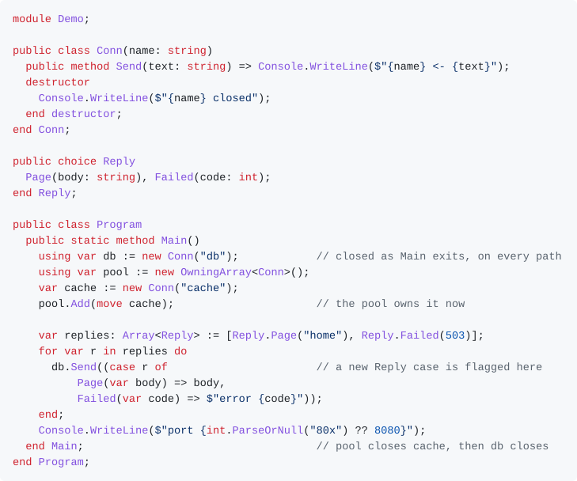

# Bezel

[](https://github.com/s8lap/bezel-lang/releases) [](https://s8lap.github.io/bezel-lang/) [](LICENSE)

**A compiled language for services and tools, with ownership-based memory management and no garbage collector.**

Bezel reads object lifetimes off ordinary code. A few keywords (`owned`, `move`, `using var`) say who owns what, and the compiler inserts every release itself, at a point you can find in the source. There is no collector and no silent memory corruption: where the compiler cannot prove a reference is still valid, the default checked build raises an exception instead of reading freed memory. In feel it is close to C#.

Bezel is written by AI models, mostly Anthropic's Claude, under the direction of its human owner. Agent commits name the model that wrote them ([Acknowledgements](#acknowledgements)).

## Status: experimental

Bezel started in April 2026 and is developed specification-first. The design is close to settled, but the compiler has not caught up, so **expect things to break**. It runs on Linux x86-64 only. Known bugs are in the [issue tracker](https://github.com/s8lap/bezel-lang/issues); if you hit another, please [report it](#reporting-a-bug).

## A first look

<picture>
  <source media="(prefers-color-scheme: dark)" srcset="docs/images/readme-example-dark.svg">
  
</picture>

<details>
<summary>The same program as text</summary>

<!-- readme-example: editors/vscode/tools/readme-example.js renders this block as docs/images/readme-example-{light,dark}.svg -->
```bezel
module Demo;

public class Conn(name: string)
  public method Send(text: string) => Console.WriteLine($"{name} <- {text}");
  destructor
    Console.WriteLine($"{name} closed");
  end destructor;
end Conn;

public choice Reply
  Page(body: string), Failed(code: int);
end Reply;

public class Program
  public static method Main()
    using var db := new Conn("db");            // closed as Main exits, on every path
    using var pool := new OwningArray<Conn>();
    var cache := new Conn("cache");
    pool.Add(move cache);                      // the pool owns it now

    var replies: Array<Reply> := [Reply.Page("home"), Reply.Failed(503)];
    for var r in replies do
      db.Send((case r of                       // a new Reply case is flagged here
          Page(var body) => body,
          Failed(var code) => $"error {code}"));
    end;
    Console.WriteLine($"port {int.ParseOrNull("80x") ?? 8080}");
  end Main;                                    // pool closes cache, then db closes
end Program;
```

</details>

It prints `db <- home`, `db <- error 503` and `port 8080`, then `cache closed` and `db closed`: owned objects are released in reverse order as `Main` exits, with no `Dispose` call written. Using `cache` after the `move` is a compile error, and a case added to `Reply` draws a warning at the `case` until it is handled. [A Tour of Bezel](https://s8lap.github.io/bezel-lang/tour/) walks through the rest of the language.

**Try it:** a prebuilt compiler for Linux x86-64 is on the [releases page](https://github.com/s8lap/bezel-lang/releases). It is a single static download with its own linker, so nothing else needs to be installed ([Getting started](#getting-started)).

## Why Bezel

- **Memory safety without a collector.** Every object has one owner and is disposed exactly once. Using a moved-out value or keeping a borrow past its owner is a compile-time error.
- **Safe across threads.** Execution domains share no mutable state, so the guarantees hold in multi-threaded code and data races are ruled out by construction.
- **Non-null by default.** A `Connection` always holds an object; only a `Connection?` may be `null`, and calling a member on it is a compile error until narrowed to non-`null` ([§7](https://s8lap.github.io/bezel-lang/spec/08-7-nullability.html#sec-nullability-2)).
- **Predictable costs and behavior.** Objects are released at points you can find in the source. Integer overflow throws instead of wrapping ([§6.1](https://s8lap.github.io/bezel-lang/spec/07-6-arithmetic-and-overflow.html#sec-integer-arithmetic)), arithmetic on a nullable value is a compile error ([§7.11](https://s8lap.github.io/bezel-lang/spec/08-7-nullability.html#sec-lifted-operators)), and user types cannot declare conversion operators ([§25.4](https://s8lap.github.io/bezel-lang/spec/26-25-operator-overloading.html#sec-no-user-defined-conversion-operators)).
- **Compared with Rust.** The ownership model is close to Rust, but there are no lifetime annotations and no single-writer rule: freedom from data races comes from domains, not from restricting aliases. The price is that a small class of mistakes Rust rejects at compile time shows up here as a deterministic run-time exception ([rationale §1](https://s8lap.github.io/bezel-lang/rationale/02-1-the-big-picture.html#sec-the-big-picture)).
- **Feature-full.** Classes, interfaces, generics, records, enums, sum types with exhaustive matching, `async`/`await` with structured concurrency, LINQ-style queries, exceptions and contracts.
- **A specification first.** Every rule is pinned by a test that states the specification's verdict, not the compiler's.

## How memory management works

The rules are in [chapter 28 of the specification](https://s8lap.github.io/bezel-lang/spec/29-28-resource-management.html#sec-resource-management). They are complicated, yet most of their weight falls on the compiler; the programmer meets three keywords, plus `using var` for a local disposed at the end of its block:

- `owned` marks a slot that holds ownership: a parameter that takes it, a return type that hands it to the caller, or a field.
- `move` transfers ownership out of a named variable. Where the destination itself announces the transfer, such as a `return` or a store into an `owned` field, no marker is needed, so every transfer is visible in the source.
- `scoped` lets a method keep a callback (or a borrowed object) beyond the call, for as long as the object that stores it lives. A plain parameter may only be used during the call; with `scoped`, the compiler checks at the call site that everything the callback captures outlives the object keeping it ([§28.14](https://s8lap.github.io/bezel-lang/spec/29-28-resource-management.html#sec-scoped-callback-parameters); [Guide 1](https://s8lap.github.io/bezel-lang/guide-01/) has a worked example).

A local initialized with a new object owns it. Every other reference is a borrow, and the compiler checks that no borrow outlives what it borrows. Only the owner may dispose an object ([§28.6](https://s8lap.github.io/bezel-lang/spec/29-28-resource-management.html#sec-who-may-dispose)): `Dispose()` runs its cleanup and marks it disposed, and the memory is released by code the compiler inserts at the owner's release point, such as the end of a scope. Trying to use an object after it has been disposed is either a compile error or a `DisposedAccessException` in the default build.

**Threads.** Code runs in execution domains ([§30.13](https://s8lap.github.io/bezel-lang/spec/31-30-asynchronous-programming.html#sec-runtime-model)). A domain runs one piece of code at a time; domains run in parallel but share no mutable state, and a value passes between them only by being moved or as an immutable copy ([§30.14](https://s8lap.github.io/bezel-lang/spec/31-30-asynchronous-programming.html#sec-multiple-domains)). That keeps the memory guarantees in multi-threaded programs and rules out data races, with one documented limit: an alias the compiler cannot see, made before the move, is the programmer's responsibility.

**Reference counting.** No class you write is ever reference-counted. The runtime manages strings, boxed values and closures itself, and the current one counts their references; it also counts the cells of variables captured by a lambda whose lifetime the compiler cannot bound statically. Shared ownership is opt-in, with `Shared<T>` and `Weak<T>` ([§28.9](https://s8lap.github.io/bezel-lang/spec/29-28-resource-management.html#sec-runtime-managed-types), [§28.13](https://s8lap.github.io/bezel-lang/spec/29-28-resource-management.html#sec-shared-ownership)).

## Getting started

**Prebuilt compiler.** Download the archive for the latest build from the [releases page](https://github.com/s8lap/bezel-lang/releases) (Linux x86-64; builds are pre-releases for now). `bin/bezelc` is fully static and links programs with the toolchain bundled beside it, and the programs it produces are fully static too, so they run on any x86-64 Linux. The archive's own `README.md` covers the options, such as `--link=system` for AddressSanitizer builds.

```sh
tar xzf bezelc-<version>-linux-x86_64.tar.gz
export PATH="$PWD/bezelc-<version>-linux-x86_64/bin:$PATH"
```

**From source.** Bezel builds on Linux with clang and LLVM 21. It is developed and tested on Fedora; other platforms are untested ([#446](https://github.com/s8lap/bezel-lang/issues/446)).

```sh
sudo dnf install cmake clang llvm llvm-devel      # LLVM 21
cmake -B build -DCMAKE_CXX_COMPILER=clang++
cmake --build build -j$(nproc)                    # the compiler is build/bezelc
```

Write `hello.bzl`:

```bezel
module Hello;

public class Program
  public static method Main(): int
    Console.WriteLine("Hello, Bezel!");
    return 0;
  end Main;
end Program;
```

and run it:

```sh
bezelc hello.bzl -o hello && ./hello
```

`Main`'s return value becomes the exit code. Libraries compile separately and are imported by their object file: `bezelc -c lib.bzl -o lib.o`, then `bezelc app.bzl --import lib.o -o app`.

## Learn the language

| Start with | What it is |
|---|---|
| [A Tour of Bezel](https://s8lap.github.io/bezel-lang/tour/) | the language in half an hour: syntax, ownership, errors, collections, concurrency, contracts |
| [The guides](https://s8lap.github.io/bezel-lang/guide-01/) | short, example-first: memory and ownership, errors and nullability, modelling data, concurrency, collections, contracts, style |
| [Writing reference](https://s8lap.github.io/bezel-lang/writing/) | the whole syntax, the ownership rules as a checklist, every library name with its signature, and the shapes that look right but are rejected |
| [Standard library](https://s8lap.github.io/bezel-lang/stdlib/) | every type and member; if a name is not there, it does not exist |
| [Language specification](https://s8lap.github.io/bezel-lang/spec/) | the normative reference, with the full grammar and the compiler-enforced invariants |
| [Design rationale](https://s8lap.github.io/bezel-lang/rationale/) | why each decision was made, and what was declined |
| [Design proposals](docs/proposals/README.md) | how the language was argued into shape: about 190 proposals, accepted, declined and pending, each with the alternatives it weighed |

A few proposals are good reading on their own:

- [0046, the ownership kernel](docs/proposals/0046-ownership-kernel-consolidation.md): the memory rules had grown rule by rule into case law; this restates them as nine kernel rules (K1–K9) and a register of axioms, with every rule traced back to them.
- [0174, the replacing `move`](docs/proposals/0174-replacing-move.md): `move loc with e` takes the value out of an owned field or slot and puts a new one in, in one step, so no owned location is ever left empty.
- [0077, silent tracking](docs/proposals/0077-silent-tracking.md): classes that hold no resources need no `using var` and draw no warnings, yet each instance still has a known owner and is freed at a known point, with no runtime lifetime mechanism on any class you write.
- [0131, the trust-admission report](docs/proposals/0131-report-trust-admissions.md): where the guarantees stop. A build mode warns at every place the compiler accepts a borrow on trust rather than proof, naming the source and the static spelling that would replace the trust.

Apart from the proposals, these are published together as a searchable site, one page per chapter, at **[s8lap.github.io/bezel-lang](https://s8lap.github.io/bezel-lang/)**. The site is rebuilt from `docs/` by `scripts/build_book.py` whenever the documents change on main.

**Editor support:** [`editors/vscode/`](editors/vscode/) is a VS Code extension with syntax highlighting, editing rules and snippets. Its grammar is generated from the specification.

## How far along is it

- **The compiler**, `bezelc`, is an ahead-of-time front end and LLVM back end. It compiles the language's core end to end — ownership and borrow checking, classes and generics, records, enums and choices, exceptions, collections and queries, `async`/`await`, multi-module builds — and much of the standard library.
- **The tests.** About 45,000 behavior tests compile and run real programs, with an AddressSanitizer pass before anything lands on main, and 2,500 diagnostic tests pin the compiler's error messages.
- **The gap** is measured. A rule corpus of one hand-written case per specification rule ([`tests/conformance/rules/`](tests/conformance/rules/)) records where the compiler still differs: of the 3,085 cases with a recorded result, 2,873 match the specification. Every difference has a tracking issue.

## Reporting a bug

Bug reports are very welcome. Please [open an issue](https://github.com/s8lap/bezel-lang/issues/new/choose) with:

- the compiler version (`bezelc --version`, or the release you downloaded);
- the smallest `.bzl` program that shows the problem;
- what the compiler or the program did, and what you expected.

Questions about what the specification means are welcome too. A crash, a leak or a memory error in a compiled program is always a bug.

## Contributing and testing

The project works specification first: if the compiler and the specification disagree, the compiler is wrong, and every fix ships a regression test that cites the section it enforces. [`CONTRIBUTING.md`](CONTRIBUTING.md) explains how to build, test and send a change, [`tests/README.md`](tests/README.md) how to write a test, and [`docs/proposals/spec-change-process.md`](docs/proposals/spec-change-process.md) how the language itself changes. [`CLAUDE.md`](CLAUDE.md) holds the stricter working rules the project's AI agents follow.

```sh
tests/run_parallel.sh 16                    # the behaviour suite, sharded
cmake --build build --target check-lit      # the diagnostic suite (needs lit and FileCheck)
scripts/check_docs.sh                       # the documentation checks
```

## Acknowledgements

Bezel is AI-written: the specification, the compiler, the tests and the research notes are the work of AI models. About three quarters of the attributed commits are by Anthropic's Claude models, which also wrote nearly all of the specification; about a quarter are by MiniMax models, mostly compiler and test work; and a small share in mid-2026 came from Z.AI's GLM. The human owner, [s8lap](https://github.com/s8lap), directs the work, makes the design decisions and reviews the results.

Agent commits end with a `Co-Authored-By` trailer naming the model that wrote them, and the trailers are never stripped. Since September 2026 the gate checks every commit for exactly one (`scripts/check_commit_trailers.py`); some earlier commits and merges have none. To tally them in a full clone:

```sh
git log --format='%(trailers:key=Co-Authored-By,valueonly)' | grep . | sed 's/ <.*//; s/ (.*//' | sort | uniq -c | sort -rn
```

## License

Apache 2.0. See [`LICENSE`](LICENSE).
