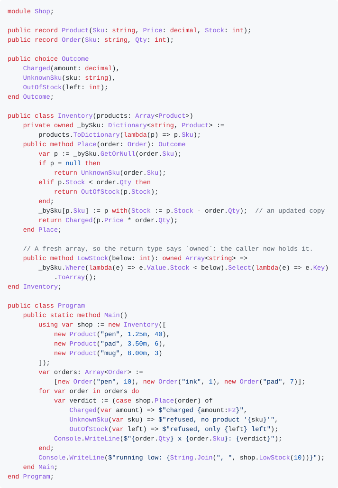

# Bezel

**A compiled language for services and tools, with ownership-based memory management and no garbage collector.**

Memory management in general-purpose languages is still a trade-off. Manual management is fast but easy to get wrong: a missed free leaks, an early one corrupts memory. Garbage collection and automatic reference counting remove those errors, but they cost time and memory at run time, and a collector adds pauses. Bezel takes a third route. The compiler knows, for every object, where it is created, who owns it, and the exact point at which it is released. It inserts the release itself, on the normal path and when an exception passes through. The effect is close to C++'s RAII, except that the compiler checks the rules instead of leaving them to discipline. There is no collector, no hidden reference count on any class you write (only the opt-in `Shared<T>` counts), and no pause.

**Try it:** a prebuilt compiler for Linux x86-64 is on the [releases page](https://github.com/s8lap/bezel-lang/releases). It is a single static download with its own linker, so nothing else needs to be installed ([Getting started](#getting-started)).

## A first look

Bezel's syntax comes from the Pascal family: blocks close with `end`, assignment is `:=` and equality is `=`. Its type system is close to C#'s, and its standard library borrows many .NET names, but the resemblance is on the surface: the library is its own design, built around ownership. The program below has a sum type (`choice`), `case` and `if` used as expressions, a function value, and lambdas passed to query operators:

<picture>
  <source media="(prefers-color-scheme: dark)" srcset="docs/images/readme-example-dark.svg">
  
</picture>

<details>
<summary>The same program as text</summary>

<!-- readme-example: editors/vscode/tools/readme-example.js renders this block as docs/images/readme-example-{light,dark}.svg -->
```bezel
module Shapes;

// A sum type: each value is exactly one of the cases.
public choice Shape
    Circle(radius: double),
    Rectangle(width: double, height: double),
    Dot;  // a case with no payload
end Shape;

public class Program
    // `case` as an expression. The compiler checks that every case is covered.
    public static method Area(s: Shape): double => (case s of
        Circle(var r) => Math.Pi * r * r,
        Rectangle(var w, var h) => w * h,
        Dot => 0.0);

    public static method Main()
        var shapes: Array<Shape> := [
            Shape.Circle(1.0),
            Shape.Rectangle(2.0, 3.0),
            Shape.Dot,
            Shape.Rectangle(4.0, 4.0)
        ];

        // A function value. The lambda's parameter type comes from the declared type.
        var describe: (Shape) -> string := lambda(s) => (case s of
            Circle(var r) => $"circle of radius {r}",
            Rectangle(var w, var h) =>
                (if w = h then $"square of side {w}" else $"rectangle {w} by {h}"),
            Dot => "dot");

        for var s in shapes do
            Console.WriteLine($"{describe(s)}: area {Area(s):F2}");
        end;

        // The first lambda captures the local `threshold`.
        var threshold := 5.0;
        var large := shapes.Where(lambda(s) => Area(s) > threshold).Count();
        var total := shapes.Select(lambda(s) => Area(s)).Sum();
        Console.WriteLine($"{large} of {shapes.Count} shapes exceed {threshold}");
        Console.WriteLine($"total area {total:F2}");
    end Main;
end Program;
```

</details>

Adding a case to `Shape` makes both `case` expressions fail to compile until they handle it. [A Tour of Bezel](docs/Bezel_Tour.md) walks through the rest of the language.

**Status: experimental.** The language design is close to settled and is written down in full; the compiler implements most of it and is still being brought up to the specification. Expect rough edges, and expect the language to change. There are no stability guarantees yet.

Most of the language already works. The remaining bugs are mostly memory errors where two features meet, and each one is tracked in the issue tracker. A few current examples:
- an owning collection created directly in an argument list leaks when a later argument throws ([#6670](https://github.com/s8lap/bezel-lang/issues/6670));
- a lambda that captures a string and is passed to a constructor leaks its capture cell when the calling method declares another local ([#6628](https://github.com/s8lap/bezel-lang/issues/6628));
- a plain `var` local holding an `Array<string?>` is never reclaimed, so its storage and every element leak ([#6516](https://github.com/s8lap/bezel-lang/issues/6516));
- a user-defined operator whose parameter is a standard collection interface crashes when its body uses the operand ([#6655](https://github.com/s8lap/bezel-lang/issues/6655)).

## How memory management works

The rules are in [chapter 28 of the specification](docs/Bezel_Language_Spec.md#sec-resource-management). They are long because they are precise, but most of their weight falls on the compiler, which tracks ownership through every statement. The programmer meets three ownership keywords, plus `using var` for a local disposed at the end of its block:

- **`owned`** marks a slot that holds ownership: a parameter that takes it, a return type that hands it to the caller, or a field that holds it until it is replaced or its object is disposed.
- **`move`** transfers ownership out of a named variable at a use site, for example into an `owned` parameter. Where the destination itself announces the transfer, such as a `return` or a store into an `owned` field, no marker is written. Either way, every transfer is visible in the source.
- **`scoped`** lets a method keep something it was given, typically a callback, beyond the call. See below.

A local initialized with a new object (`new`, or a call whose return type is `owned`) owns it. Every other reference is a **borrow**: a reference passed around without transferring ownership. The compiler checks that no borrow outlives what it borrows, so a dangling reference is a compile-time error.

**What `scoped` is for.** A lambda is only safe while everything it captured is still alive. By default, a method that receives a lambda may call it but may not keep it: storing it in a field, in a collection or in a returned closure is a compile error, because the method's signature says nothing about how long the captured values live. Declaring the parameter `scoped` says *"I will keep this for as long as the object that stores it lives"*, and the compiler then checks the caller's side:

```bezel
class Timer
  private scoped _onTick: (() -> ())?;              // a scoped field: it can be invoked, replaced or cleared, never read out
  public method OnTick(scoped handler: () -> ())
    _onTick := handler;                              // allowed: stored in the object that received it
  end OnTick;
  public method Tick()
    _onTick?();                                      // call the handler if one is set
  end Tick;
end Timer;

using var conn := new Connection("db");              // declared before the timer
using var timer := new Timer();
timer.OnTick(lambda() => conn.Send("ping"));         // the lambda borrows conn; timer stores the lambda
timer.Tick();
// while timer lives, conn cannot be moved, reassigned or disposed
```

The call is accepted because `conn` is declared before `timer`, so it is disposed after `timer` at the end of the block. If the two `using var` lines are swapped, the call is rejected and the message names `conn`. If `timer` is a plain `var` with no fixed end, only lambdas that capture nothing are accepted. The same mechanism lets an object keep a borrowed object rather than a lambda (`new Statement(scoped account)`), and the standard library uses it for event subscriptions and for `TaskScope.Spawn` ([§28.14](docs/Bezel_Language_Spec.md#sec-scoped-callback-parameters); [Guide 1](docs/Bezel_Guide_01_Memory_and_Ownership.md) has more).

Only an object's owner may dispose it ([§28.6](docs/Bezel_Language_Spec.md#sec-who-may-dispose)). Calling `Dispose()` runs the object's cleanup, its destructor, and marks it disposed. It does not free the memory. The memory is always released by code the compiler inserts at the owner's release point: the end of a scope, the overwrite of a field, the disposal of the object that holds it. Using an object after it has been disposed raises `DisposedAccessException` in the default build instead of reading freed memory.

**Where reference counting is used.** No class you write is ever reference-counted. The specification lets the runtime manage four kinds of value by whatever mechanism it chooses: strings, `Type` tokens, boxed values and function values ([§28.9](docs/Bezel_Language_Spec.md#sec-runtime-managed-types)). It asks for counting only where a program opts in, with `Shared<T>` and `Weak<T>` ([§28.13](docs/Bezel_Language_Spec.md#sec-shared-ownership)). The current compiler and runtime count references in these places:

- strings, boxed values and closures (`Type` tokens are interned and never freed);
- the cell holding a variable that a lambda captures, but only when the compiler cannot prove where the lambda's environment dies, for example when a capturing lambda is passed to another method. The last holder frees the cell;
- `Shared<T>` and `Weak<T>` handles;
- runtime internals that never appear as user objects: tasks, cancellation token sources, and the shared cores of `Semaphore` and the atomics.

## Why Bezel

- **Memory safety without a collector.** Every object has exactly one owner and is disposed exactly once. Using a moved-out value and keeping a borrow past its owner are compile-time errors; a resource is never dropped without being disposed; where a stale reference can still arise at run time, the default build fails with an exception instead of corrupting memory.
- **No null surprises.** A class type is non-nullable unless it is written with `?`: a `Connection` always holds an object, a `Connection?` may hold `null` ([§7](docs/Bezel_Language_Spec.md#sec-nullability-2)). The compiler enforces the difference at every assignment, argument and return, and calling a member on a `Connection?` is a compile error until a check such as `if c <> null then` has narrowed it. A non-nullable field must be initialized where it is declared or by every constructor ([§7.9](docs/Bezel_Language_Spec.md#sec-definite-assignment-for-non-nullable-fields)). Absence is handled explicitly with `?.`, `??` and `??=`, and `!` asserts presence, raising `NullReferenceException` if the value is null.
- **Ownership you can read.** The declaration says who owns a slot (`owned` on a parameter, a return type or a field); the use site, or the `owned` slot it stores into, says when ownership moves (`move`). An assignment never transfers anything silently.
- **Familiar everywhere else.** Classes, interfaces, generics, records, enums, sum types (`choice`) with exhaustive matching, `async`/`await` with structured concurrency, LINQ-style queries, exceptions, and contracts (`requires`/`ensures`) — in a syntax that reads like the Pascal family with the type system of C#.
- **A specification first.** The language is defined by a normative specification, and every rule is pinned by a test that states the specification's verdict, not the compiler's.

## Getting started

**Prebuilt compiler.** Download the archive for the latest build from the [releases page](https://github.com/s8lap/bezel-lang/releases) (Linux x86-64; builds are pre-releases for now). `bin/bezelc` is fully static and links programs with the toolchain bundled beside it, and the programs it produces are fully static too, so they run on any x86-64 Linux. The archive's own `README.md` covers the options, such as `--link=system` for AddressSanitizer builds.

```sh
tar xzf bezelc-<version>-linux-x86_64.tar.gz
export PATH="$PWD/bezelc-<version>-linux-x86_64/bin:$PATH"
```

**From source.** Bezel builds on Linux with clang and LLVM 21. It is developed and tested on Fedora; other platforms are untested ([#446](https://github.com/s8lap/bezel-lang/issues/446)).

```sh
sudo dnf install cmake clang llvm llvm-devel      # LLVM 21
cmake -B build -DCMAKE_CXX_COMPILER=clang++
cmake --build build -j$(nproc)                    # the compiler is build/bezelc
```

Write `hello.bzl`:

```bezel
module Hello;

public class Program
  public static method Main(): int
    Console.WriteLine("Hello, Bezel!");
    return 0;
  end Main;
end Program;
```

and run it:

```sh
bezelc hello.bzl -o hello && ./hello
```

`Main`'s return value becomes the exit code. Libraries compile separately and are imported by their object file: `bezelc -c lib.bzl -o lib.o`, then `bezelc app.bzl --import lib.o -o app`.

## Learn the language

| Start with | What it is |
|---|---|
| [A Tour of Bezel](docs/Bezel_Tour.md) | the language in half an hour: syntax, ownership, errors, collections, concurrency, contracts |
| [The guides](docs/Bezel_Guide_01_Memory_and_Ownership.md) | short, example-first: memory and ownership, errors and nullability, modelling data, concurrency, collections, contracts, style |
| [Writing reference](docs/Bezel_For_Code_Generation.md) | the whole syntax, the ownership rules as a checklist, every library name with its signature, and the shapes that look right but are rejected |
| [Standard library](docs/Bezel_Standard_Library.md) | every type and member; if a name is not there, it does not exist |
| [Language specification](docs/Bezel_Language_Spec.md) | the normative reference, with the full grammar and the compiler-enforced invariants |
| [Design rationale](docs/Bezel_Design_Rationale.md) | why each decision was made, and what was declined |

`scripts/build_book.py` builds the same documents into a searchable site, one page per chapter; it is published to GitHub Pages once Pages is enabled for the repository.

**Editor support:** [`editors/vscode/`](editors/vscode/) is a VS Code extension with syntax highlighting, editing rules and snippets. Its grammar is generated from the specification.

## How far along is it

- **The design** is written down in full: the [specification](docs/Bezel_Language_Spec.md), the [standard library](docs/Bezel_Standard_Library.md) and the [rationale](docs/Bezel_Design_Rationale.md), with one [changelog](docs/Bezel_Changelog.md) entry per revision.
- **The compiler**, `bezelc`, is an ahead-of-time front end and LLVM back end. It compiles the language's core end to end — ownership and borrow checking, classes and generics, records, enums and choices, exceptions, collections and queries, `async`/`await`, multi-module builds — and much of the standard library.
- **The gap** is measured. A rule corpus of one hand-written case per specification rule ([`tests/conformance/rules/`](tests/conformance/rules/)) records where the compiler still differs: of the 2,671 cases with a recorded result, 2,462 match the specification. Every difference has a tracking issue.

## Repository layout

```text
src/      the compiler: lexer, parser, semantic analysis, ownership, codegen, runtime, modules, driver
tests/    behaviour tests (gtest), diagnostic tests (lit + FileCheck), the conformance corpora
docs/     specification, standard library, rationale, changelog, tour and guides
editors/  editor support (VS Code)
scripts/  build, test and documentation tooling
```

## Contributing and testing

The project works specification first: if the compiler and the specification disagree, the compiler is wrong, and every fix ships a regression test that cites the section it enforces. [`CLAUDE.md`](CLAUDE.md) is the project's working discipline, [`tests/README.md`](tests/README.md) explains how to write a test, and [`docs/proposals/spec-change-process.md`](docs/proposals/spec-change-process.md) describes how the language itself changes.

```sh
tests/run_parallel.sh 16                    # the behaviour suite, sharded (~2 min)
cmake --build build --target check-lit      # the diagnostic suite (needs lit and FileCheck)
scripts/gate.sh                             # both, with a combined total
scripts/check_docs.sh                       # the documentation checks
```

## Acknowledgements

Bezel was built with [Claude](https://www.anthropic.com/claude), Anthropic's AI model, working through Claude Code under the project owner's direction. Claude wrote most of the specification text, the compiler, its runtime and its tests, and reviewed its own work through independent review passes; the commits it wrote carry a `Co-Authored-By: Claude` trailer. The project owner directs the design and decides what lands.

## License

Apache 2.0. See [`LICENSE`](LICENSE).
